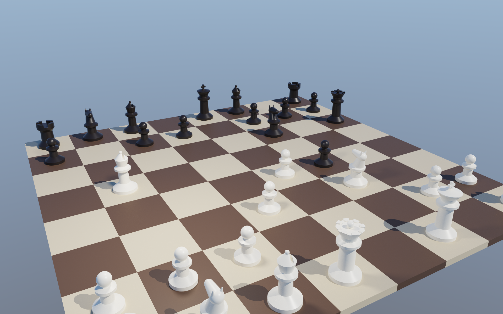
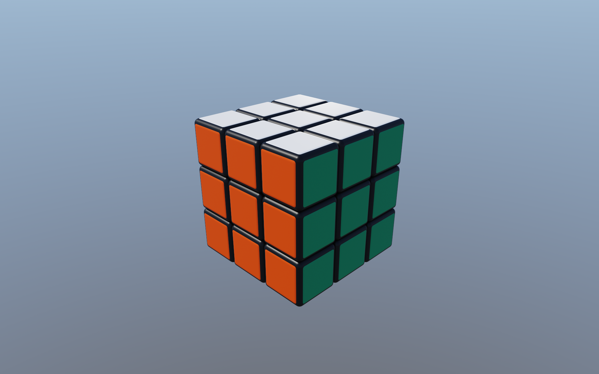
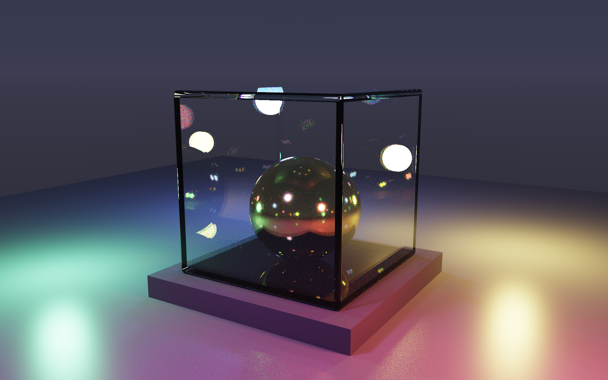
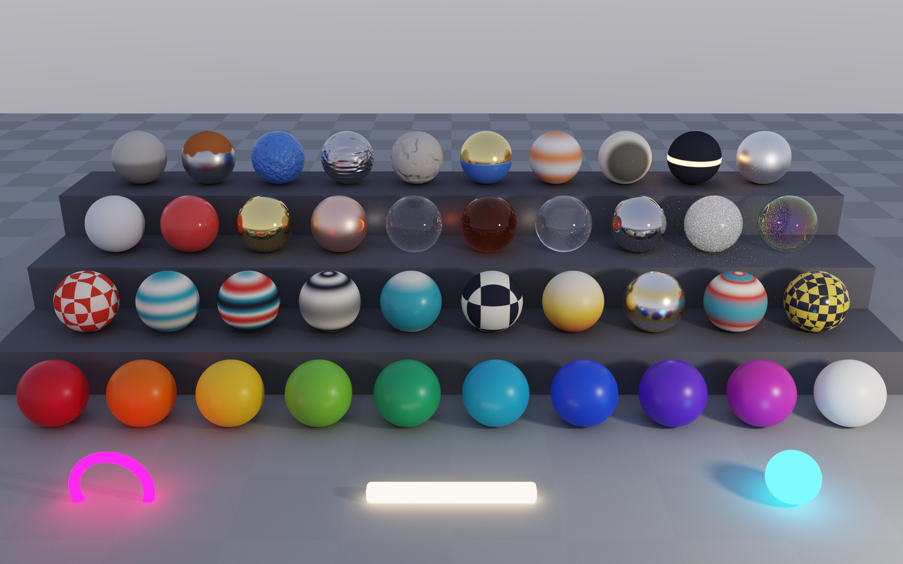

# Kodanuki

Kodanuki is a spectral path-tracer for a custom SDF based file format.
A minimal core defines how the renderer works. Plugins plug into
extension points to provide features or optimizations.



## Requirements

Linux, GCC with C++26, CMake 3.28 or newer, Ninja and Python 3.11 or
newer. The viewer also needs SDL3 installed.

## Usage

The `Makefile` names a scene and a config (see target/configs):

```
SCENE  := scenes/chess-board.sdf
CONFIG := target/configs/render_final.toml
```

You can execute the following commands:

```
make render  Draw one frame to output/<scene>.ppm at the given config
make viewer  Opens a window that renders the scene interactively
```

## Disclaimer

The project is quite fresh and thus probably contains multiple bugs,
I will not guarantee a stable SDF file format or ABI (yet).

I've used Claude Opus 5.5 to write most of the code. I've spent a
bit of time on code quality, but comments etc still read weird.

## Gallery

<table>
<tr><td></td><td></td></tr>
<tr><td></td><td></td></tr>
<tr><td></td><td></td></tr>
<tr><td></td></tr>
</table>
